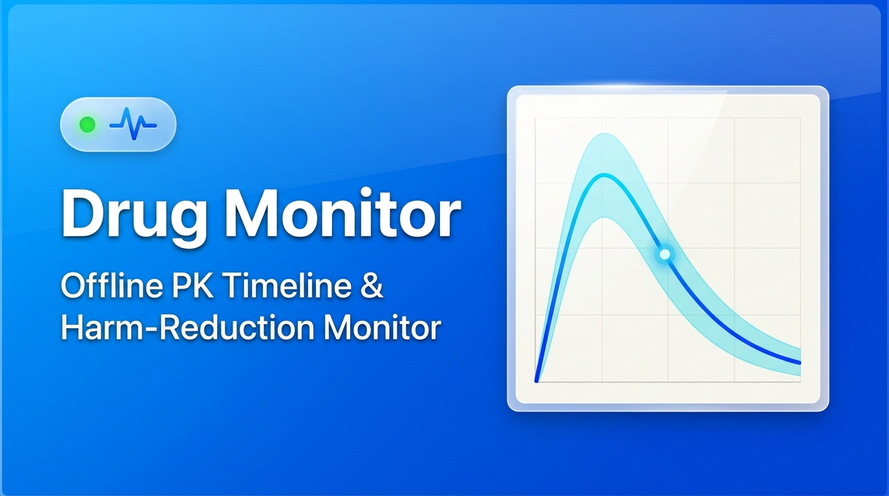
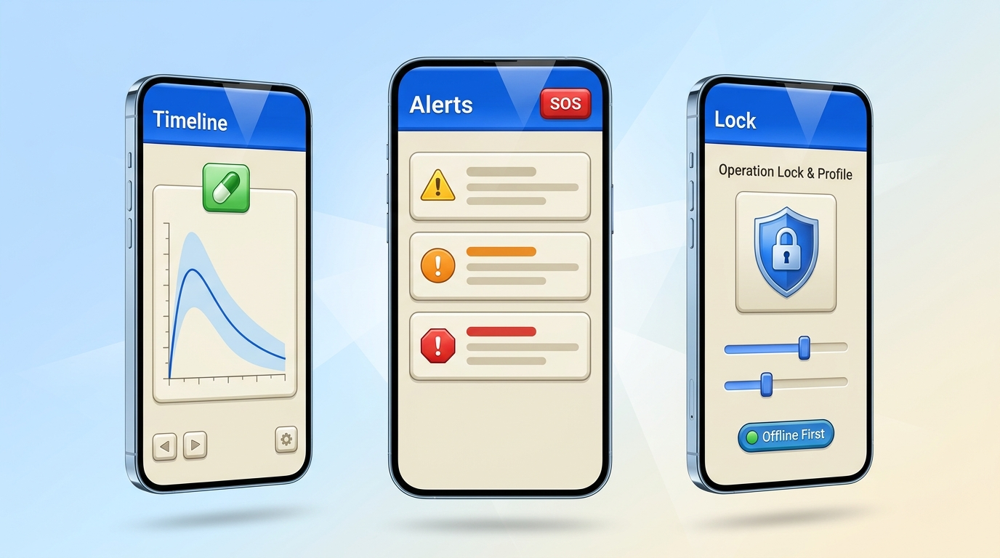
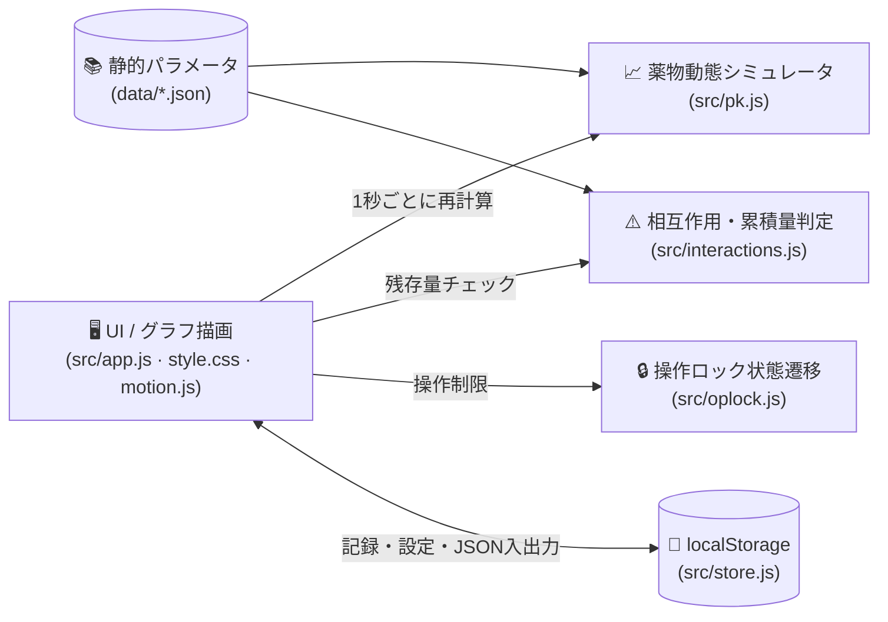

<div align="center">



# Drug Monitor（摂取薬物モニター）

**摂取した薬・物質の予想血中濃度・作用の段階・相互作用をリアルタイムに可視化する**<br>
**端末内完結型の静的 PWA / Capacitor iOS アプリ（ハームリダクション用途）**

<p>
  
  
  
  
  
</p>

<p>
  <a href="#-画面イメージ">画面イメージ</a> •
  <a href="#-主な機能">主な機能</a> •
  <a href="#-アーキテクチャ">アーキテクチャ</a> •
  <a href="#-使い方">使い方</a> •
  <a href="#-開発テストビルド">開発・ビルド</a> •
  <a href="#-ディレクトリ構成">構成</a>
</p>

</div>

---

> [!WARNING]
> **免責事項**
> 表示される血中濃度・作用の段階は母集団平均に基づく推定値であり、実際の血中濃度や体感とは大きく異なることがあります。**服薬・用量の判断や医療上の意思決定には絶対に使用しないでください。**
> 体調に異変がある場合や意識障害・呼吸異常・けいれん等がある場合は、ただちに救急（119）または中毒情報センターへ連絡してください。

---

## 🖼️ 画面イメージ

<div align="center">
  
  <p><sub>※ Windows XP Luna 風の視認性の高いクラシック UI で、タイムライン・警告・緊急導線・操作ロックを直感的に操作できます（イメージ図）。</sub></p>
</div>

---

## ✨ 主な機能

<table>
  <tr>
    <td width="50%" valign="top">
      <h3>📈 リアルタイム濃度タイムライン</h3>
      過去〜未来の予想血中濃度（ピーク比 %）と、個人差・用量幅を反映した<strong>不確実性の帯</strong>を 1 秒ごとにグラフ更新。活性代謝物や非線形消失（0次・飽和性）にも対応しています。
    </td>
    <td width="50%" valign="top">
      <h3>⚠️ 相互作用・累積量警告</h3>
      現在の体内残存量から相互作用（<strong>注意 / 危険 / 命に関わる</strong>）および添付文書基準の累積量上限を判定。データがない組み合わせは「安全」と表示せず<strong>「データなし」</strong>と明示します。
    </td>
  </tr>
  <tr>
    <td width="50%" valign="top">
      <h3>💊 摂取記録と履歴管理</h3>
      製品・物質、摂取量（範囲指定可）、投与経路、摂取日時を記録し、一覧・編集・削除が可能。市販薬などの<strong>複数成分製品は成分ごとに自動展開</strong>されます。
    </td>
    <td width="50%" valign="top">
      <h3>🧭 作用の段階表示</h3>
      効果部位モデルに基づき、現在のフェーズを<strong>「立ち上がり / ピーク域 / コムダウン / ほぼ消失」</strong>でわかりやすく表示します。
    </td>
  </tr>
  <tr>
    <td width="50%" valign="top">
      <h3>🚑 緊急連絡先への常時導線</h3>
      ヘッダーの<strong>「緊急」ボタン</strong>および警告一覧から、119・中毒110番・相談窓口へいつでもワンタップでアクセスできます。
    </td>
    <td width="50%" valign="top">
      <h3>🔒 操作ロックモード</h3>
      閲覧・リアルタイム更新・警告・緊急導線を維持したまま、記録の追加・編集・削除や設定変更を一定時間ロック。<strong>待機時間＋認知課題</strong>による早期解除にも対応します。
    </td>
  </tr>
  <tr>
    <td width="50%" valign="top">
      <h3>🧬 プロフィール補正</h3>
      体重・年齢・性別・喫煙・腎機能（eGFR）・CYP2D6 型をもとに薬物動態の推定パラメータを補正します。
    </td>
    <td width="50%" valign="top">
      <h3>📴 オフライン動作 & 端末内保存</h3>
      外部サーバーへの送信・解析ツールは一切なし。データはすべて端末の <code>localStorage</code> に保存され、<strong>JSON エクスポート / インポート</strong>・全データ削除に対応しています。
    </td>
  </tr>
</table>

---

## 📊 収録データ概要

薬物動態や相互作用の判定ロジックは、出典とステータスを管理したローカル JSON データに基づいています。

| データファイル | 収録数 | 役割 |
| :--- | :---: | :--- |
| [`data/drugs.json`](data/drugs.json) | **14 物質** | 薬物動態パラメータ（出典・`status` 必須） |
| [`data/products.json`](data/products.json) | **3 製品** | 市販薬などの製品 → 含有成分マッピング |
| [`data/interactions.json`](data/interactions.json) | **17 ルール** | 物質間の相互作用リスク（注意 / 危険 / 命に関わる） |
| [`data/limits.json`](data/limits.json) | **4 基準** | 添付文書基準の累積量上限 |

---

## 🏗️ アーキテクチャ

すべての計算・状態管理・永続化は端末内（ブラウザ / iOS WebView）で完結し、外部通信を行いません。



---

## 🚀 使い方

### 🌐 Web / PWA として使う

静的ファイルのみで動作します。ローカルで試す場合は、任意の静的サーバーでルートディレクトリを配信してください。

```bash
npx serve .
```

### 📱 iOS アプリとして使う（サイドロード）

[GitHub Releases](https://github.com/teamkller1200/drug_monitor/releases) で配布している署名なし `DrugMonitor.ipa` をダウンロードし、AltStore / SideStore / Sideloadly 等のサイドロードツールで署名してインストールしてください。

---

## 🛠️ 開発・テスト・ビルド

**Node.js 22 以上**を推奨します。

```bash
# 依存パッケージのインストール（Capacitor / iOS ビルド用）
npm ci

# ユニットテストの実行（PK計算・相互作用・データ整合性・ストア・操作ロック等）
npm test

# www/ へ静的アセットをコピー
npm run build

# ビルド後に Capacitor iOS プロジェクトへ同期
npm run ios:sync
```

> [!NOTE]
> `npm test` は Node.js 標準のテストランナー（`node --test`）を使用しており、外部依存なしで高速に実行できます。

### ⚙️ CI / 自動ビルド

[`.github/workflows/ios-ipa.yml`](.github/workflows/ios-ipa.yml) により、Web アセットや iOS 設定の変更を push すると GitHub Actions（macOS ランナー）上で **テスト実行 → Capacitor 同期 → 署名なし IPA ビルド** が自動で走り、成果物が Artifact としてアップロードされます。

---

## 📁 ディレクトリ構成

```text
.
├── index.html               # エントリ HTML
├── manifest.json / sw.js    # PWA マニフェスト・Service Worker
├── capacitor.config.json    # Capacitor 設定
├── docs/images/             # README 用ビジュアルアセット
├── src/
│   ├── app.js               # UI・画面遷移・グラフ描画・1秒更新
│   ├── style.css            # スタイルシート（Windows XP Luna 風テーマ）
│   ├── pk.js                # 薬物動態シミュレータ（純粋関数）
│   ├── interactions.js      # 相互作用・累積量判定（純粋関数）
│   ├── store.js             # localStorage 永続化・エクスポート/インポート
│   ├── oplock.js            # 操作ロックの状態遷移（純粋関数）
│   └── motion.js            # シートのスプリング・ドラッグ操作
├── data/
│   ├── drugs.json           # 物質パラメータ（出典・status 必須）
│   ├── products.json        # 製品→成分マッピング
│   ├── interactions.json    # 相互作用ルール
│   └── limits.json          # 累積量上限
├── test/                    # ユニットテスト
├── scripts/build-www.mjs    # Capacitor 用アセットコピー
├── ios/                     # Capacitor iOS プロジェクト
├── REQUIREMENTS.md          # 要件定義
└── DESIGN.md                # 基本設計
```

---

## 📚 関連ドキュメント

詳細な要件・設計については以下を参照してください。

- 📋 [REQUIREMENTS.md](REQUIREMENTS.md) — 要件定義
- 📐 [DESIGN.md](DESIGN.md) — 基本設計
