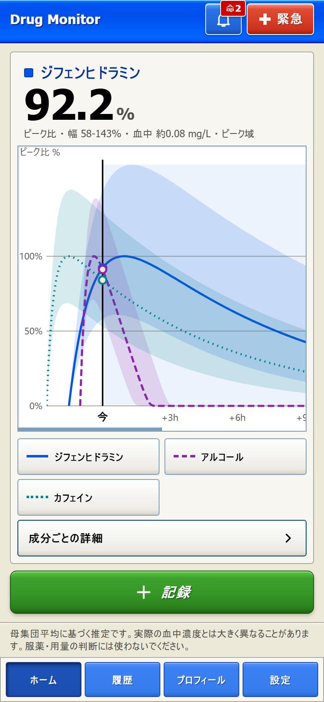
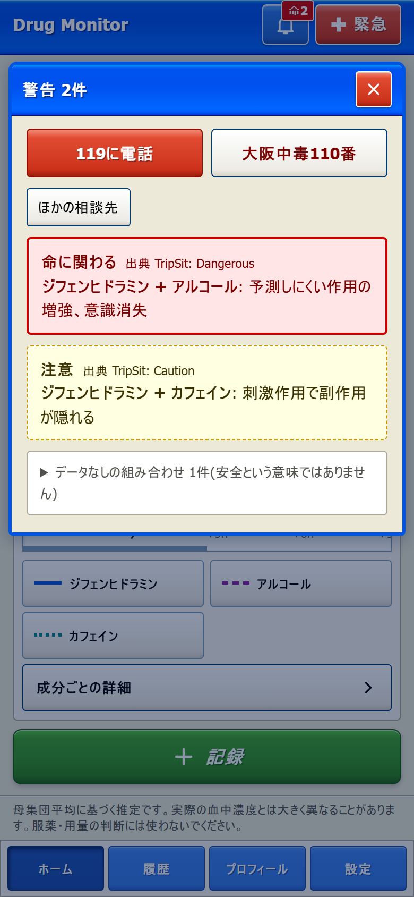
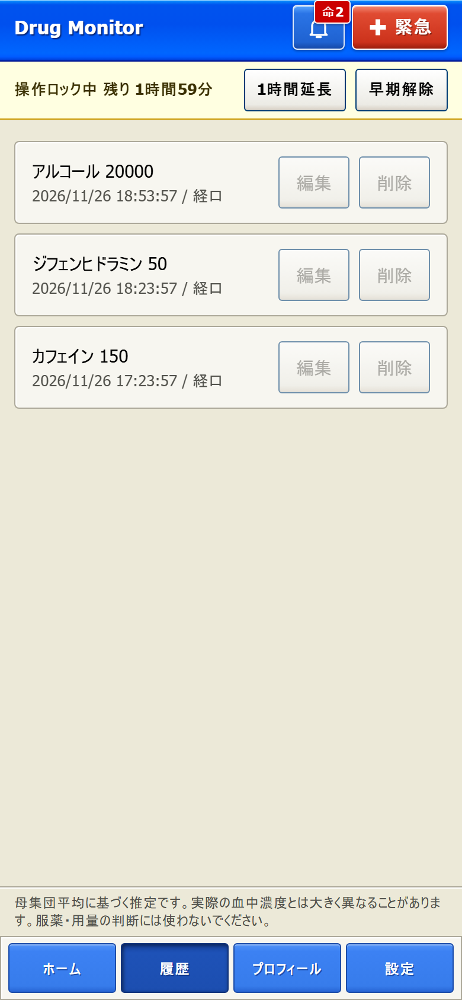
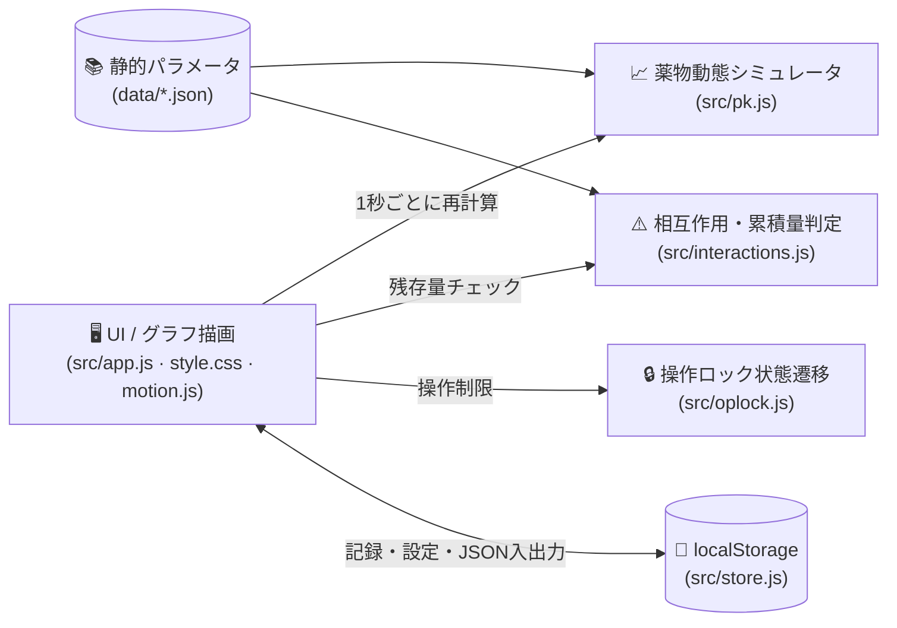

<div align="center">

# Drug Monitor（摂取薬物モニター）

**摂取した薬・物質の予想血中濃度、作用の段階、相互作用・累積量のリスクをリアルタイムに可視化する、**<br>
**端末内完結型のハームリダクションアプリ**

<p>
  <a href="#-画面イメージ">画面イメージ</a> •
  <a href="#-主な機能">主な機能</a> •
  <a href="#-はじめかた">はじめかた</a> •
  <a href="#-プライバシーと安全設計">プライバシーと安全設計</a> •
  <a href="#-開発者向け情報">開発者向け情報</a>
</p>

</div>

---

> [!WARNING]
> **免責事項**
> 表示される血中濃度や作用の段階は、一般的なデータに基づく**推定値**であり、体質・体調によって実際の血中濃度や体感とは大きく異なることがあります。
> **服薬・用量の判断や医療上の意思決定には絶対に使用しないでください。**
> 体調に異変がある場合や、意識障害・呼吸異常・けいれん等がある場合は、ただちに **救急（119番）** または **中毒110番** へ連絡してください。

---

## 🖼️ 画面イメージ

<div align="center">
  <table>
    <tr>
      <td align="center" width="33%">
        <br>
        <sub><strong>タイムライン</strong></sub>
      </td>
      <td align="center" width="33%">
        <br>
        <sub><strong>警告・緊急連絡</strong></sub>
      </td>
      <td align="center" width="33%">
        <br>
        <sub><strong>操作ロック・履歴</strong></sub>
      </td>
    </tr>
  </table>
  <p><sub>※ 実際のアプリ画面（サンプルデータ表示例）です。</sub></p>
</div>

---

## ✨ 主な機能

<table>
  <tr>
    <td width="50%" valign="top">
      <h3>📈 リアルタイム濃度タイムライン</h3>
      過去から未来にかけての予想血中濃度（ピーク比 %）と、個人差・用量幅を反映した<strong>不確実性の帯</strong>を 1 秒ごとにグラフ更新します。
    </td>
    <td width="50%" valign="top">
      <h3>⚠️ 相互作用・累積量の警告</h3>
      現在の体内残存量から相互作用（<strong>注意 / 危険 / 命に関わる</strong>）および累積量の上限を自動判定します。未収録の組み合わせを「安全」と表示せず、<strong>「データなし」</strong>と明示します。
    </td>
  </tr>
  <tr>
    <td width="50%" valign="top">
      <h3>💊 摂取記録と履歴管理</h3>
      物質・製品、摂取量（範囲指定可）、投与経路、摂取日時を記録し、一覧の確認・編集・削除が可能です。複数成分を含む市販薬は<strong>成分ごとに自動展開</strong>して計算します。
    </td>
    <td width="50%" valign="top">
      <h3>🧭 作用の段階表示</h3>
      効果の推移に基づき、現在の状態を<strong>「立ち上がり / ピーク域 / コムダウン / ほぼ消失」</strong>の 4 段階でわかりやすく表示します。
    </td>
  </tr>
  <tr>
    <td width="50%" valign="top">
      <h3>🚑 緊急連絡先への常時導線</h3>
      ヘッダーに常時表示される<strong>「緊急」ボタン</strong>や警告一覧から、119 番・中毒 110 番・相談窓口へ迷わずアクセスできます。
    </td>
    <td width="50%" valign="top">
      <h3>🔒 操作ロックモード</h3>
      グラフの閲覧・リアルタイム更新・警告確認・緊急導線を維持したまま、記録の追加・編集・削除や設定変更を一定時間ロックできます。早期解除には<strong>待機時間と確認課題</strong>が必要です。
    </td>
  </tr>
  <tr>
    <td width="50%" valign="top">
      <h3>🧬 プロフィールによる推定補正</h3>
      体重・年齢・性別・喫煙の有無・腎機能・代謝体質などを設定することで、体質に合わせて推定パラメータを補正します。
    </td>
    <td width="50%" valign="top">
      <h3>📴 オフライン動作と端末内保存</h3>
      通信環境がなくても動作します。記録はすべて端末内にのみ保存され、<strong>JSON 形式でのバックアップ書き出し／読み込み</strong>や<strong>全データ削除</strong>に対応しています。
    </td>
  </tr>
</table>

---

## 🚀 はじめかた

### 📱 iPhone アプリとして使う

1. [GitHub Releases](https://github.com/teamkller1200/drug_monitor/releases) から最新の `DrugMonitor.ipa` をダウンロードします。
2. [**AltStore**](https://github.com/altstoreio/AltStore) / [**SideStore**](https://github.com/SideStore/SideStore) / [**Sideloadly**](https://sideloadly.io/) 等のサイドロードツールで署名し、端末へインストールします。
3. インストール後、アカウント登録なしですぐに利用できます。

### 🌐 Web / PWA として使う

静的ファイルのみで動作するため、PC・スマートフォンのブラウザからも利用できます。ローカル環境で起動する場合は、任意の静的サーバーでルートディレクトリを配信してください。

```bash
npx serve .
```

> [!TIP]
> スマートフォンのブラウザで開き「ホーム画面に追加」を実行すると、通常のアプリと同様に全画面・オフラインで利用できます。

---

## 🔐 プライバシーと安全設計

- **データは端末内のみに保存**: 入力した摂取記録や設定が外部サーバーへ送信されることはありません。
- **登録・トラッキング不要**: アカウント登録は不要で、アクセス解析や広告トラッキングも一切含まれません。
- **出典に基づく収録データ**: 現在、**14 種類の物質**・**3 種類の市販製品**・**17 件の相互作用ルール**・**4 件の累積量上限基準**をアプリ内に収録しています。

---

## 🛠️ 開発者向け情報

<details>
<summary><strong>アーキテクチャ・テスト・ビルド手順・ディレクトリ構成を見る</strong></summary>

### 🏗️ アーキテクチャ

すべての計算・状態管理・永続化は端末内（ブラウザ / Capacitor iOS WebView）で完結し、外部通信を行いません。



### 📊 収録データファイル

| データファイル | 収録数 | 役割 |
| :--- | :---: | :--- |
| [`data/drugs.json`](data/drugs.json) | **14 物質** | 薬物動態パラメータ（出典・`status` 必須） |
| [`data/products.json`](data/products.json) | **3 製品** | 市販薬などの製品 → 含有成分マッピング |
| [`data/interactions.json`](data/interactions.json) | **17 ルール** | 物質間の相互作用リスク（注意 / 危険 / 命に関わる） |
| [`data/limits.json`](data/limits.json) | **4 基準** | 添付文書基準の累積量上限 |

### 💻 開発・テスト・ビルド

**Node.js 22 以上**を推奨します。

```bash
# 依存パッケージのインストール（Capacitor / iOS ビルド用）
npm ci

# ユニットテストの実行（PK計算・相互作用・データ整合性・ストア・操作ロック等）
npm test

# www/ へ静的アセットをコピー
npm run build

# ビルド後に Capacitor iOS プロジェクトへ同期
npm run ios:sync
```

> `npm test` は Node.js 標準のテストランナー（`node --test`）を使用しており、外部依存なしで実行できます。

### ⚙️ CI / 自動ビルド

[`.github/workflows/ios-ipa.yml`](.github/workflows/ios-ipa.yml) により、Web アセットや iOS 設定の変更を push すると GitHub Actions（macOS ランナー）上で **テスト実行 → Capacitor 同期 → 署名なし IPA ビルド** が自動で走り、成果物が Artifact としてアップロードされます。

### 📁 ディレクトリ構成

```text
.
├── index.html               # エントリ HTML
├── manifest.json / sw.js    # PWA マニフェスト・Service Worker
├── capacitor.config.json    # Capacitor 設定
├── docs/images/             # README 用ビジュアルアセット
├── src/
│   ├── app.js               # UI・画面遷移・グラフ描画・1秒更新
│   ├── style.css            # スタイルシート（Windows XP Luna 風テーマ）
│   ├── pk.js                # 薬物動態シミュレータ（純粋関数）
│   ├── interactions.js      # 相互作用・累積量判定（純粋関数）
│   ├── store.js             # localStorage 永続化・エクスポート/インポート
│   ├── oplock.js            # 操作ロックの状態遷移（純粋関数）
│   └── motion.js            # シートのスプリング・ドラッグ操作
├── data/
│   ├── drugs.json           # 物質パラメータ（出典・status 必須）
│   ├── products.json        # 製品→成分マッピング
│   ├── interactions.json    # 相互作用ルール
│   └── limits.json          # 累積量上限
├── test/                    # ユニットテスト
├── scripts/build-www.mjs    # Capacitor 用アセットコピー
├── ios/                     # Capacitor iOS プロジェクト
├── REQUIREMENTS.md          # 要件定義
└── DESIGN.md                # 基本設計
```

### 📚 関連ドキュメント

- 📋 [REQUIREMENTS.md](REQUIREMENTS.md) — 要件定義
- 📐 [DESIGN.md](DESIGN.md) — 基本設計

</details>
